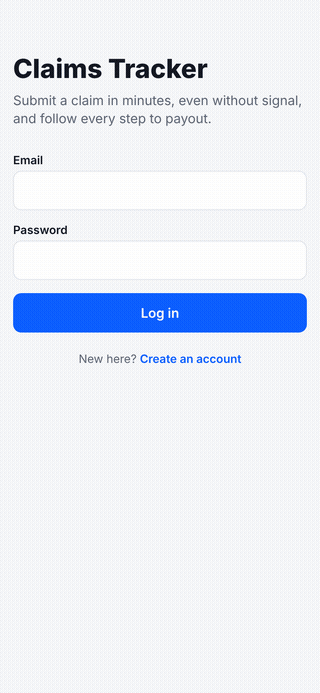
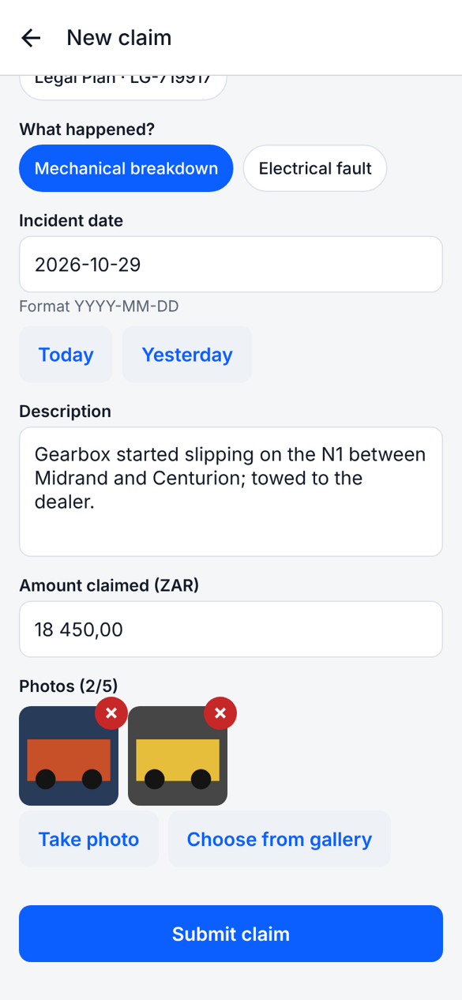
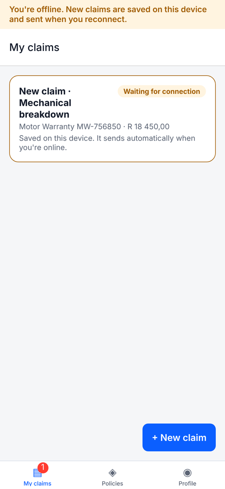
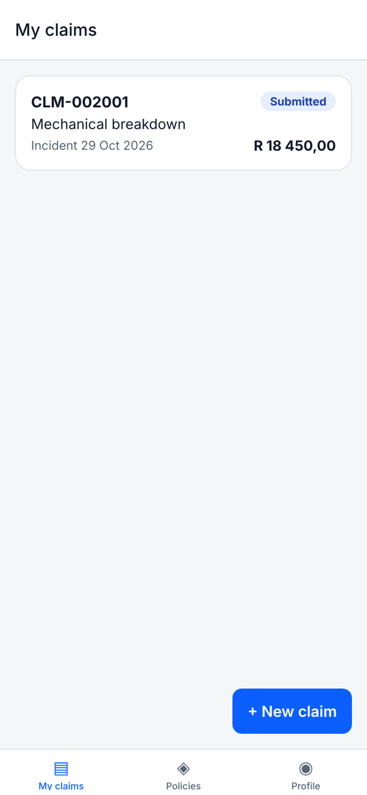
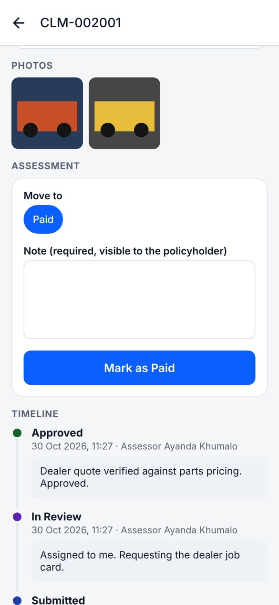
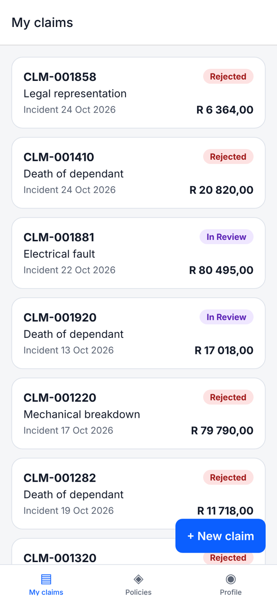
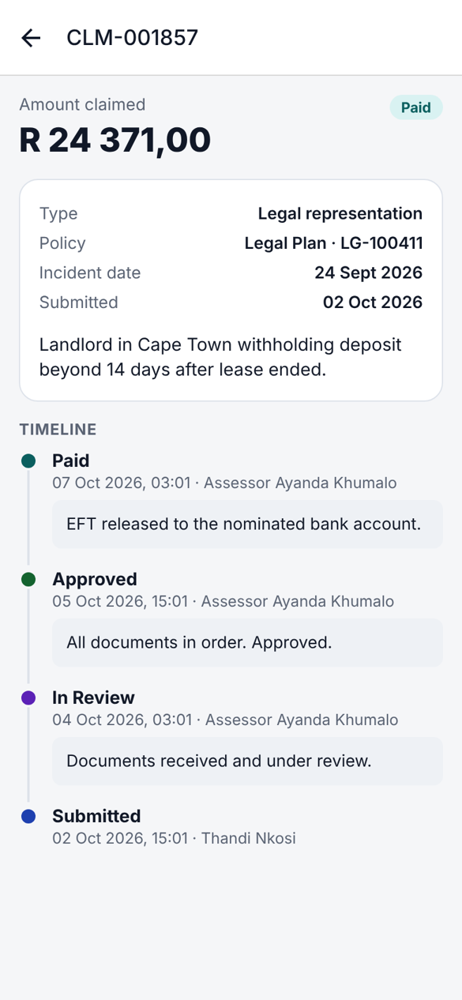
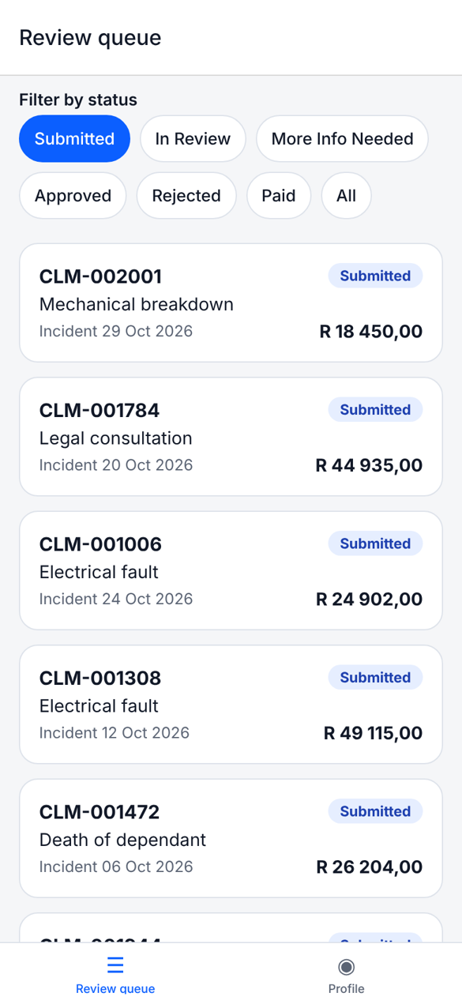
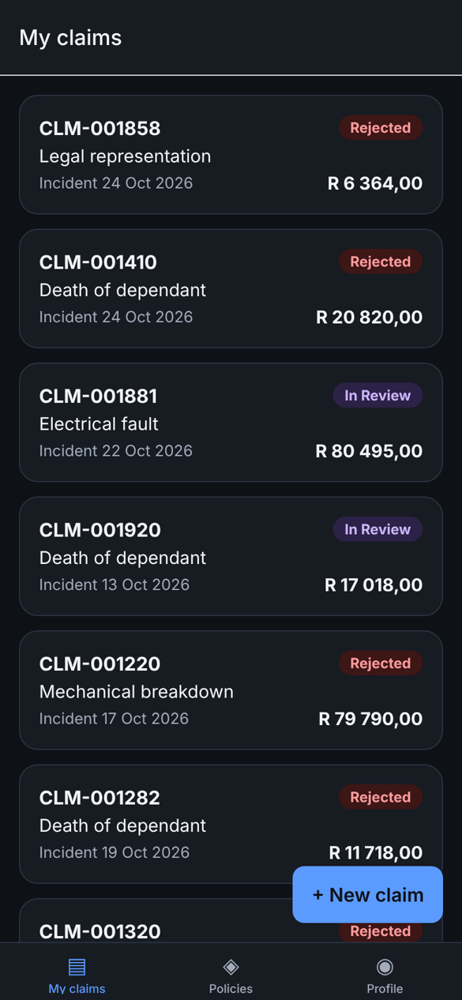
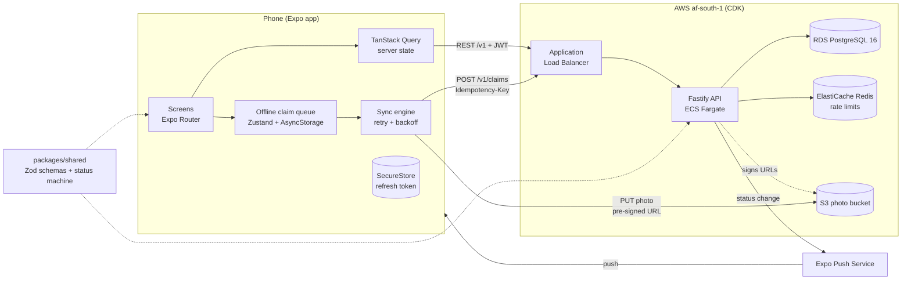

# Claims Tracker

[](https://github.com/tashen247/claims-tracker-mobile/actions/workflows/ci.yml)


A mobile app for insurance policyholders to submit and track claims, with a review queue for claims
assessors. Claims can be captured with no signal and are sent automatically, without duplicates, once
the phone is back online.

**Stack:** Expo (React Native, TypeScript) · Fastify · PostgreSQL · S3 pre-signed uploads · Redis ·
AWS CDK (ECS Fargate, RDS, ElastiCache) · Vitest, Jest and React Native Testing Library · GitHub Actions

<p align="center">
  
</p>

|                           Capture offline                           |                         Queued on device                         |                   Synced on reconnect                    |                          Assessor approves                          |
| :-----------------------------------------------------------------: | :--------------------------------------------------------------: | :------------------------------------------------------: | :-----------------------------------------------------------------: |
|  |  |  |  |

|                          Claims list                          |                         Claim timeline                         |                           Review queue                           |                             Dark mode                              |
| :-----------------------------------------------------------: | :------------------------------------------------------------: | :--------------------------------------------------------------: | :----------------------------------------------------------------: |
|  |  |  |  |

## Features

**Policyholder**

- Sign up and log in (JWT access token plus rotating refresh token held in SecureStore)
- View policies (motor warranty, funeral, legal)
- Submit a claim: policy, claim type, incident date, description, amount in rand, 1 to 5 photos from
  the camera or gallery
- Offline-first: claims are saved on the device and synced on reconnect with retry and backoff
- Claims list with status chips (Submitted, In Review, More Info Needed, Approved, Rejected, Paid)
- Claim detail with photos, status timeline and assessor notes
- Push notification when a claim's status changes, which opens the claim
- Dark mode, screen-reader labels, and loading, empty and error states throughout

**Assessor** (same app, role-gated)

- Review queue filtered by status
- Change status with a required note; only valid transitions are offered, and every change is
  written to an audit trail

## Architecture



```
apps/
  api/        Fastify REST API, Drizzle migrations, seed, tests, Dockerfile
  mobile/     Expo app (Expo Router), offline queue, tests
packages/
  shared/     Zod schemas, types, claim status machine, ZAR helpers
infra/        AWS CDK stack (Fargate, RDS, S3, ElastiCache)
docs/         ADRs and screenshots
```

## Running locally

Requirements: Node 22, pnpm 10, Docker. Expo Go on a phone, or an iOS/Android simulator.

```bash
pnpm install
docker compose up -d                       # Postgres, Redis and LocalStack S3
cp apps/api/.env.example apps/api/.env
cp apps/mobile/.env.example apps/mobile/.env
pnpm db:migrate && pnpm db:seed            # schema + South African demo data (1,000 claims)
pnpm dev                                   # API on :3000 and the Expo dev server
```

- API docs (OpenAPI generated from the Zod schemas): http://localhost:3000/docs
- Health check: http://localhost:3000/health

**On a physical phone**, `localhost` is the phone itself. Set `EXPO_PUBLIC_API_URL` in
`apps/mobile/.env` and `S3_PUBLIC_ENDPOINT` in `apps/api/.env` to your computer's LAN IP
(e.g. `http://192.168.1.20:3000` and `http://192.168.1.20:4566`).

**Push notifications** need a real device and an EAS project ID (`npx eas init` in `apps/mobile`).
In simulators and the web preview the app skips push registration.

### Demo logins

| Role         | Email                    | Password       |
| ------------ | ------------------------ | -------------- |
| Policyholder | `thandi@example.co.za`   | `Password123!` |
| Assessor     | `assessor@example.co.za` | `Password123!` |

New sign-ups get one motor warranty, funeral and legal policy so the full flow can be tried
straight away.

### Demo flow

1. Register a new account in the app.
2. Turn on flight mode, tap **New claim**, fill it in, add a photo and submit. It appears as
   "Waiting to send".
3. Turn flight mode off. The claim syncs, gets a `CLM-` reference and shows as Submitted.
4. Log in as the assessor, open the claim from the review queue, move it to In Review and then
   Approved with a note.
5. The policyholder's phone receives a push notification; tapping it opens the claim timeline.

## API

All routes are versioned under `/v1`; money is integer cents (ZAR).

| Method            | Path                                                                         | Notes                                                                       |
| ----------------- | ---------------------------------------------------------------------------- | --------------------------------------------------------------------------- |
| `POST`            | `/v1/auth/register`, `/v1/auth/login`, `/v1/auth/refresh`, `/v1/auth/logout` | Rate limited                                                                |
| `GET`             | `/v1/me`                                                                     | Current user                                                                |
| `POST` / `DELETE` | `/v1/me/push-tokens`                                                         | Register or remove an Expo push token                                       |
| `GET`             | `/v1/policies`                                                               | Caller's policies                                                           |
| `POST`            | `/v1/claims`                                                                 | Requires `Idempotency-Key`; replays return the original claim               |
| `GET`             | `/v1/claims`                                                                 | Own claims (policyholder) or all (assessor); `status`, `limit`, `pageToken` |
| `GET`             | `/v1/claims/:id`                                                             | Detail with photo URLs and status timeline                                  |
| `POST`            | `/v1/claims/:id/photos/upload-url`                                           | Pre-signed S3 PUT URL; max 5 photos                                         |
| `PATCH`           | `/v1/claims/:id/status`                                                      | Assessor only; note required; writes an audit event                         |
| `GET`             | `/health`                                                                    | Database and Redis checks                                                   |

Every response carries an `x-correlation-id` header (a caller-supplied one is reused), and the same
ID is on every log line for that request.

## Design decisions

Short ADRs live in [`docs/decisions`](docs/decisions).

- **Idempotent submission** ([ADR 0002](docs/decisions/0002-idempotent-claim-submission.md)): the
  device generates an `Idempotency-Key` once per claim and reuses it on every retry. Keys are unique
  per user; the request body hash is stored so a reused key with a different body gets `409`.
  Concurrent duplicates are resolved by `ON CONFLICT` in Postgres.
- **Offline queue** ([ADR 0003](docs/decisions/0003-offline-first-claim-queue.md)): every claim,
  online or offline, goes through one on-device queue. A pure, unit-tested sync engine creates the
  claim, uploads outstanding photos and resumes where it left off after failures, backing off
  exponentially. Server rejections are flagged for the user instead of retried forever.
- **Pre-signed uploads** ([ADR 0004](docs/decisions/0004-pre-signed-s3-uploads.md)): photos go
  straight from the phone to S3. The API only signs short-lived URLs for keys it generates, and
  enforces the photo limit under a row lock.
- **Shared schemas** ([ADR 0001](docs/decisions/0001-monorepo-with-shared-zod-schemas.md)): the
  same Zod schemas validate the app's forms, the API's requests and generate the OpenAPI spec. The
  status machine is shared too, so the app only offers transitions the API accepts.
- **Auth** ([ADR 0006](docs/decisions/0006-auth-tokens.md)): 15-minute access tokens, rotating
  refresh tokens with reuse detection, and roles enforced on the server.
- **Drizzle** ([ADR 0005](docs/decisions/0005-drizzle-over-prisma.md)): SQL-first schema and
  migrations, applied at container start under an advisory lock.

## Testing

```bash
pnpm test                 # all workspaces
pnpm test:coverage        # with coverage gates (70% on api and shared)
pnpm lint && pnpm typecheck
pnpm --filter @claims/api bench   # p95 latency of list endpoints against the seeded data
```

| Package           | What is covered                                                                                                                                                                                                                                                                                |
| ----------------- | ---------------------------------------------------------------------------------------------------------------------------------------------------------------------------------------------------------------------------------------------------------------------------------------------- |
| `apps/api`        | Unit tests plus integration tests against a real Postgres (Testcontainers): auth and token rotation, rate limiting, idempotency including concurrent retries, role checks, photo limits, status transitions, audit trail, push clean-up, OpenAPI, seed data validity. About 97% line coverage. |
| `packages/shared` | Schemas, status machine, ZAR parsing and formatting. 100% line coverage.                                                                                                                                                                                                                       |
| `apps/mobile`     | Claim form validation and submission, claims list states, offline queue and sync engine (offline, partial upload, rejection, backoff), API client refresh logic.                                                                                                                               |
| `infra`           | CDK assertion tests on the synthesized template (encryption, public access, health checks, prod hardening).                                                                                                                                                                                    |

Integration tests start `postgres:16-alpine` with Testcontainers. To use an existing database instead,
set `TEST_DATABASE_URL` (it is wiped).

**Performance:** with 1,000 seeded claims, `pnpm --filter @claims/api bench` measured list endpoints
at p95 under 7 ms locally, against a 200 ms budget. Lists use keyset pagination over
`(created_at, id)` with matching indexes.

## CI/CD

GitHub Actions on every push and pull request ([`ci.yml`](.github/workflows/ci.yml)):

- ESLint + Prettier, TypeScript type checks
- API and shared tests with coverage gates (Postgres via Testcontainers)
- Mobile tests and a Metro bundle check
- CDK assertion tests and `cdk synth`
- API Docker image build

[`eas-preview.yml`](.github/workflows/eas-preview.yml) is a manual workflow that builds an installable
preview with EAS (needs an `EXPO_TOKEN` secret).

## Deploying

See [`infra/README.md`](infra/README.md). In short:

```bash
pnpm --filter @claims/infra deploy -c stage=dev
```

This builds the API image, and creates the VPC, Fargate service behind a load balancer, RDS
PostgreSQL, the S3 bucket, Redis and secrets in `af-south-1` (Cape Town). Migrations run when each
task starts.

## Licence

[MIT](LICENSE)
